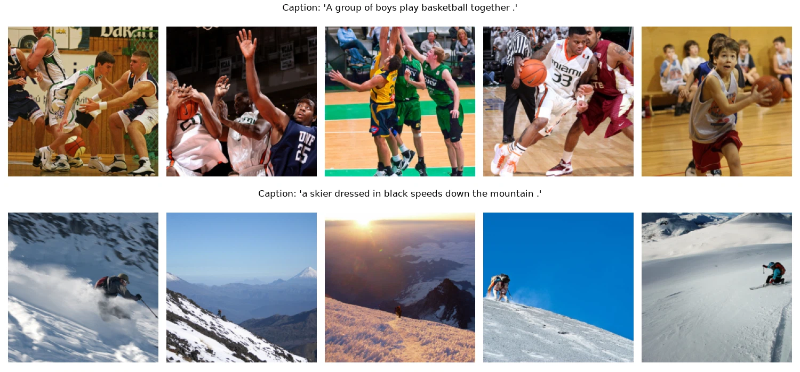

# CLIP from scratch
<div style="display: flex; gap: 5px;">
<a href="https://arxiv.org/abs/2103.00020">

</a>
</div>


###
Implementing ["Learning Transferable Visual Models From Natural Language Supervision"](https://arxiv.org/abs/2103.00020) from scratch.

### Clone and install dependencies
``` 
git clone https://github.com/alessiopiroli/clip_from_scratch
pip install -r requirements.txt 
```

### Data preparation
```
python prepare_data.py clip/config/clip_config.yaml
```

### Train
``` 
python train.py clip/config/clip_config.yaml
```

### Evaluate
```
python evaluate.py clip/config/clip_config.yaml  
```

### Qualitative results
> Examples of top-5 images retrieved for captions from the [Flickr8k](https://dl.acm.org/doi/10.5555/2566972.2566993) test set

<p align="center">
  
</p>